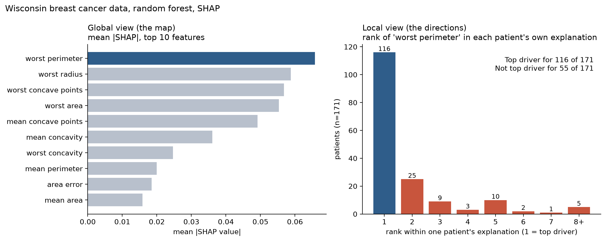
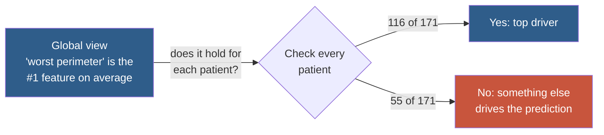
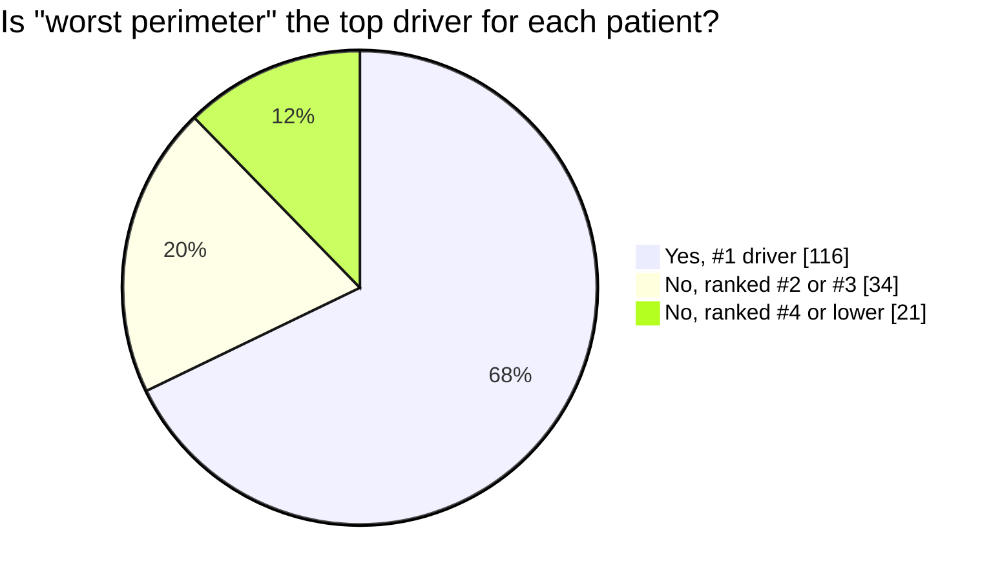
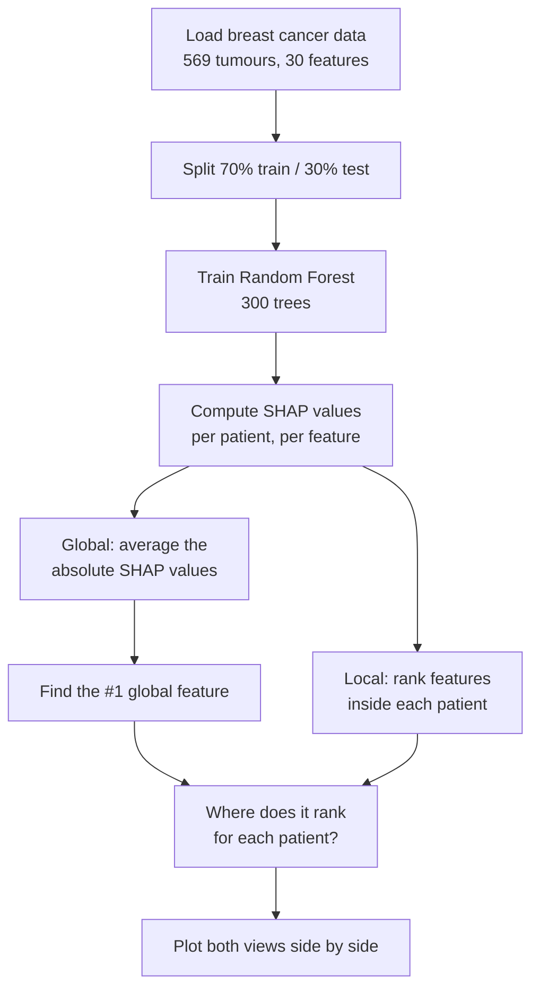

# Global vs. Local Explanations: The Map Is Not the Directions

> **The feature that matters most on average is not always the feature that matters for *you*.**

A small, reproducible demo showing why a global feature-importance chart can mislead when you use it to explain an individual prediction.



---

## The idea in 30 seconds

Think of a navigation app.

| | Navigation app | Explainable AI |
|---|---|---|
| **Global** | The city map: which roads are busiest overall | Feature importance: which features matter most on average |
| **Local** | Turn-by-turn directions for *your* trip | A SHAP explanation for *one* patient |

The busiest road in the city is not on every route. In the same way, the most important feature overall is not the main reason behind every single prediction.



## Key result

A random forest trained on the Wisconsin breast cancer dataset reaches **95.3% accuracy**. SHAP says `worst perimeter` is the most important feature globally. Checking it patient by patient (171 test patients):



- **68%** of patients: the global top feature really is their top driver.
- **32%** (55 patients): it is not.
- **12%** (21 patients): it is not even in their top 3.

Using the global chart to explain an individual patient would be wrong about a third of the time.

## How it works



**SHAP** gives every feature a score for every patient: how much that feature pushed the prediction up or down. Two ways to read those scores:

- **Global:** average the absolute scores over all patients. One ranking for the whole population.
- **Local:** rank the scores within one patient. A different ranking for each person.

## Reading the chart

| Panel | What it shows |
|---|---|
| **Left (the map)** | Top 10 features by mean absolute SHAP value. `worst perimeter` (blue) is first. |
| **Right (the directions)** | For each patient, the rank of `worst perimeter` in their own explanation. The blue bar is "it is the top driver". The red bars are "it is not". |

## Why it happens

`worst perimeter`, `worst radius` and `worst area` all measure tumour size, so they are highly correlated. The model can share credit between them differently from patient to patient. The global average hides that, and the local view shows it.

## Takeaways

1. A global ranking describes the **population**, not the **individual**.
2. For decisions about one person (a patient, a loan applicant), look at **local** explanations.
3. Report both: global for understanding the model, local for justifying a specific prediction.

## Run it yourself

```bash
python -m venv .venv
.venv\Scripts\activate        # Windows (macOS/Linux: source .venv/bin/activate)
pip install shap scikit-learn matplotlib numpy pandas
python global_vs_local_demo.py
```

Output:

```
acc 0.953
global top feature: worst perimeter
NOT top-1 locally: 55 of 171
not in top-3: 21 of 171
saved global_vs_local.png
```

## Files

| File | Purpose |
|---|---|
| `global_vs_local_demo.py` | Trains the model, computes SHAP, builds the figure |
| `global_vs_local.png` | The generated figure |

## Stack

Python · scikit-learn · SHAP · matplotlib

> **Note:** This is an educational demo on a public dataset, not a medical tool.
